# Laporan Praktikum 6: JavaScript DOM dan Event Handling

**Mata Kuliah:** Pemrograman Web  
**Dosen Pengampu:** Agung Nugroho, S.Kom., M.Kom.  
**Universitas Pelita Bangsa**

---

## 👨‍💻 Data Diri Mahasiswa
* **Nama:** Guntur Cahyadewangga
* **NIM:** 312510265
* **Program Studi:** Teknik Informatika
* **Kelas / Semester:** I251C / Semester 3

---

## 📝 Penjelasan Praktikum
Praktikum 6 mempelajari teknik manipulasi **Document Object Model (DOM)** serta penanganan interaksi pengguna (**Event Handling**) pada halaman web menggunakan bahasa pemrograman JavaScript. Pada praktikum ini, kita mempelajari cara memilih elemen HTML (menggunakan `getElementById`, `querySelector`, dan `querySelectorAll`), mengubah konten serta gaya CSS secara dinamis (`textContent`, `classList.toggle`), merespons berbagai event aksi pengguna (`click`, `input`, `submit`), melakukan validasi formulir pendaftaran, membangun aplikasi interaktif daftar tugas (*To-Do List*), hingga merancang Mini Project Form Pendaftaran Workshop beserta 5 Eksperimen Mandiri yang tercantum dalam modul.

---

## 🛠️ Langkah-Langkah & Hasil Praktikum (`Lab6Web`)

### 1. Latihan 1: Mengubah Teks dengan DOM
* **Penjelasan:** Memilih elemen HTML berdasarkan atribut `id` (`getElementById`) dan memperbarui konten teksnya secara langsung melalui JavaScript (`textContent`).
* **Screenshot Hasil:**  
  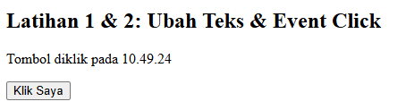

### 2. Latihan 2: Event Click dan Waktu
* **Penjelasan:** Menambahkan *event listener* `click` pada tombol aksi untuk merespons klik pengguna serta menampilkan jam/waktu eksekusi secara dinamis menggunakan `new Date().toLocaleTimeString()`.
* **Screenshot Hasil:**  
  

### 3. Latihan 3: Mengubah Kelas dan Gaya CSS (`classList.toggle`)
* **Penjelasan:** Mengubah tampilan visual elemen paragraf secara interaktif saat tombol diklik dengan mengaktifkan atau mematikan kelas CSS (`highlight` dan `teks-besar`) menggunakan `classList.toggle()`.
* **Screenshot Hasil:**  
  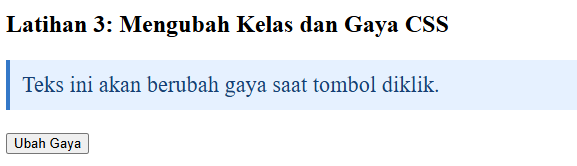

### 4. Latihan 4: Event Input & Penghitung Karakter
* **Penjelasan:** Menangkap event `input` pada elemen kolom nama untuk menghitung dan menampilkan jumlah panjang karakter (`value.length`) secara *real-time* saat pengguna mengetik.
* **Screenshot Hasil:**  
  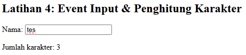

### 5. Latihan 5: Validasi Form Pendaftaran
* **Penjelasan:** Memvalidasi masukan form (Nama Lengkap, Email dengan pola *regex*, dan Usia rentang 17–100) saat event `submit` dipicu dengan menghentikan aksi bawaan form via `e.preventDefault()`.
* **Screenshot Hasil Pengujian Validasi:**  
  * **Kondisi Nama Kosong:**  
    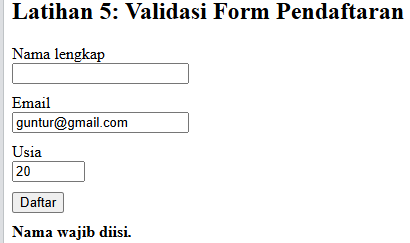  
  * **Kondisi Email Tidak Valid:**  
    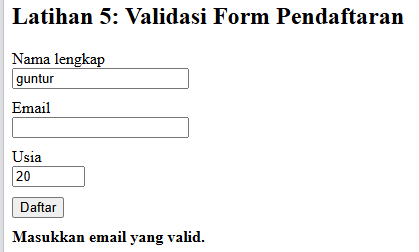  
  * **Kondisi Usia Tidak Sesuai:**  
    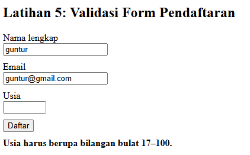  
  * **Kondisi Validasi Berhasil:**  
    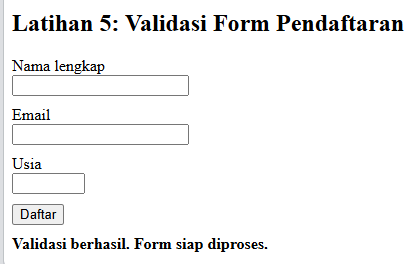

### 6. Latihan 6: Daftar Tugas Sederhana (To-Do List)
* **Penjelasan:** Membuat aplikasi *To-Do List* interaktif yang memungkinkan pengguna menambah item tugas baru ke dalam daftar `<ul>` serta menandai atau membatalkan status selesai (*line-through*).
* **Screenshot Hasil:**  
  * **Menambahkan Tugas Baru:**  
    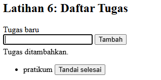  
  * **Menandai / Membatalkan Selesai:**  
    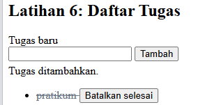

### 7. Mini Project: Form Pendaftaran Workshop
* **Penjelasan:** Membangun form pendaftaran workshop terintegrasi yang mencakup fitur penghitung sisa karakter nama (maksimal 50 karakter), validasi input, penanganan event `reset`, serta pencetakan Ringkasan Pendaftaran di bawah form secara dinamis.
* **Screenshot Hasil:**  
  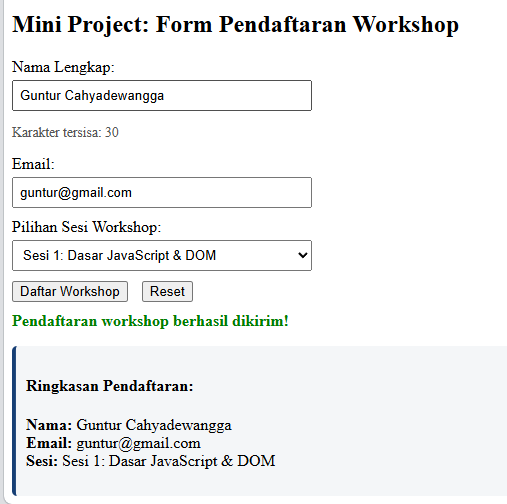

---

## 🧪 Eksperimen Mandiri

### 1. Eksperimen 1: Tombol Hapus Item pada To-Do List
* **Penjelasan:** Menambahkan tombol "Hapus" pada setiap item daftar tugas yang baru dibuat untuk menghapus elemen `<li>` terkait dari struktur DOM (`item.remove()`).
* **Screenshot Hasil:**  
  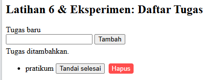

### 2. Eksperimen 2: Validasi Nama Minimal 3 Karakter
* **Penjelasan:** Memperbarui pengujian logika validasi form agar nama tidak hanya diperiksa dari kondisi kosong saja, tetapi juga wajib memiliki panjang minimal 3 karakter (`nama.length < 3`).
* **Screenshot Hasil:**  
  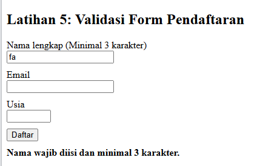

### 3. Eksperimen 3: Event `change` Dropdown Sesi Workshop
* **Penjelasan:** Menambahkan *event listener* `change` pada elemen `<select>` dropdown pilihan sesi workshop untuk menampilkan info atau pratinjau sesi yang dipilih secara langsung.
* **Screenshot Hasil:**  
  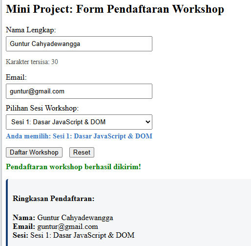

### 4. Eksperimen 4: Tombol Toggle Sembunyikan dan Tampilkan Paragraf
* **Penjelasan:** Membuat tombol khusus yang memanfaatkan manipulasi kelas CSS / gaya `display` untuk menyembunyikan atau menampilkan kembali paragraf teks pada halaman.
* **Screenshot Hasil:**  
  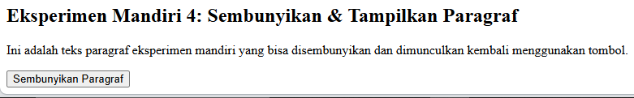

### 5. Eksperimen 5: Pengujian Script Tanpa Atribut `defer` di `<head>`
* **Penjelasan:** Memindahkan pemanggilan `` ke dalam bagian `<head>` tanpa atribut `defer`, lalu mengamati serta menganalisis kesalahan script saat dijalankan.
* **Screenshot Hasil:**  
  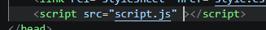  
* **Analisis & Penyebab Masalah:**  
  Saat skrip dipanggil di bagian `<head>` tanpa atribut `defer`, JavaScript akan langsung dieksekusi oleh browser **sebelum** struktur HTML di bagian `<body>` selesai diparsing (*DOM Tree* belum terbentuk). Akibatnya, fungsi pemilih elemen seperti `document.getElementById()` mengembalikan nilai `null`, sehingga memicu galat `TypeError: Cannot read properties of null` saat mencoba memasang *event listener*.

---

## ❓ Pertanyaan Evaluasi (Bagian H Modul)

### 1. Apa yang dimaksud dengan DOM dan apa manfaatnya?
**Document Object Model (DOM)** adalah antarmuka pemrograman (API) yang merepresentasikan dokumen HTML atau XML sebagai struktur pohon (*tree structure*) berisikan objek-objek.  
**Manfaatnya:** Memungkinkan bahasa pemrograman seperti JavaScript untuk mengakses, menambah, mengubah, atau menghapus elemen, atribut, dan gaya CSS pada halaman web secara dinamis tanpa perlu memuat ulang (*reload*) halaman.

### 2. Apa perbedaan `getElementById()`, `querySelector()`, dan `querySelectorAll()`?
* **`getElementById("id")`**: Memilih satu elemen spesifik berdasarkan atribut `id`. Mengembalikan satu objek elemen HTML.
* **`querySelector("selector")`**: Memilih **elemen pertama** yang cocok dengan selector CSS (bisa berdasarkan tag, id, kelas, atau atribut).
* **`querySelectorAll("selector")`**: Memilih **semua elemen** yang cocok dengan selector CSS. Mengembalikan daftar kumpulan elemen berupa `NodeList`.

### 3. Apa fungsi `addEventListener()` dan sebutkan tiga contoh event?
**Fungsi:** Menghubungkan suatu event/kejadian pengguna dengan sebuah fungsi JavaScript (*callback function*) yang akan dieksekusi saat event tersebut terjadi.  
**3 Contoh Event:**
1. `click`: Dipicu saat elemen diklik.
2. `input`: Dipicu saat nilai dari elemen input/textarea berubah saat mengetik.
3. `submit`: Dipicu saat form dikirimkan.

### 4. Mengapa `event.preventDefault()` digunakan pada event submit form?
`event.preventDefault()` digunakan untuk menghentikan atau membatalkan aksi bawaan (*default action*) dari browser—yaitu memuat ulang (*reload*) halaman atau mengirim data form ke URL tujuan secara otomatis. Dengan menahannya, kita dapat menjalankan proses validasi JavaScript di sisi klien terlebih dahulu.

### 5. Apa perbedaan `textContent` dan `innerHTML` dari sisi penggunaan dan keamanan?
* **`textContent`**: Hanya membaca atau menyisipkan teks murni. Karakter khusus HTML akan di-*escape* sebagai teks biasa. **Sangat aman** dari ancaman serangan *Cross-Site Scripting* (XSS).
* **`innerHTML`**: Membaca atau merender tag dan struktur markup HTML. **Rentan terhadap serangan XSS** jika menyisipkan data/input yang tidak terfilter dari pengguna.

### 6. Bagaimana `classList.toggle()` membantu mengubah tampilan elemen?
`classList.toggle("nama-kelas")` bekerja secara dinamis memeriksa keberadaan suatu kelas CSS pada elemen. Jika kelas tersebut **sudah ada**, maka `toggle()` akan **menghapusnya**. Jika kelas tersebut **belum ada**, maka `toggle()` akan **menambahkannya**. Ini memudahkan pembuatan fitur interaktif seperti sakelar *mode gelap*, penyembunyian elemen, atau perubahan gaya visual saat diklik.

### 7. Sebutkan minimal tiga skenario pengujian validasi form!
1. **Pengujian Input Kosong:** Menekan tombol kirim saat seluruh atau salah satu kolom wajib (misal: Nama) dalam keadaan kosong.
2. **Pengujian Format/Pola Tidak Valid:** Memasukkan string teks tanpa karakter `@` atau domain pada kolom Email.
3. **Pengujian Rentang Nilai/Batas:** Memasukkan angka di luar batas yang ditentukan (misalnya mengisi Usia dengan angka 10 atau 150, padahal batas rentang yang diizinkan adalah 17–100).